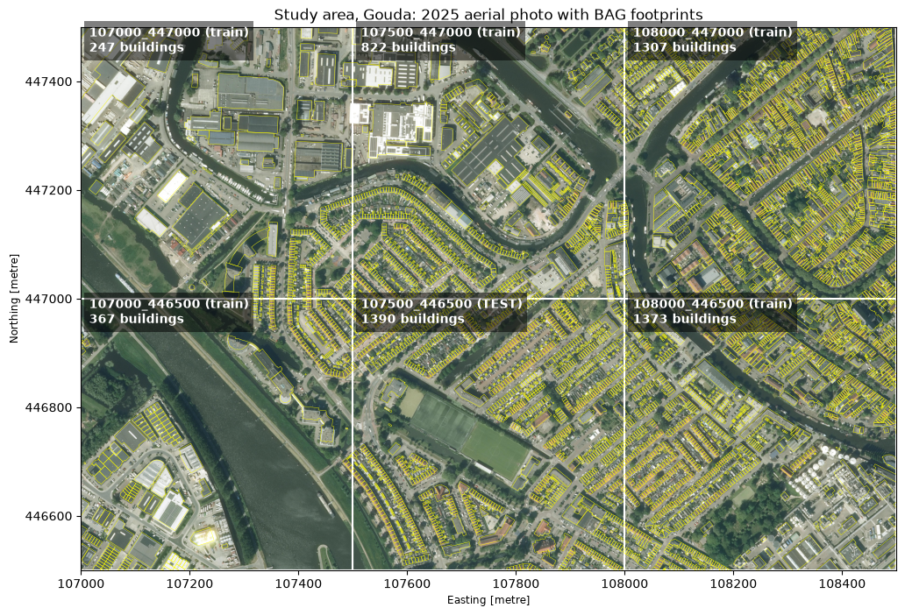
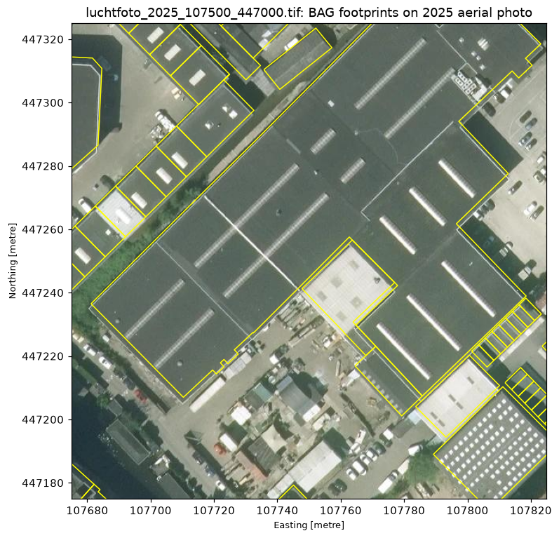
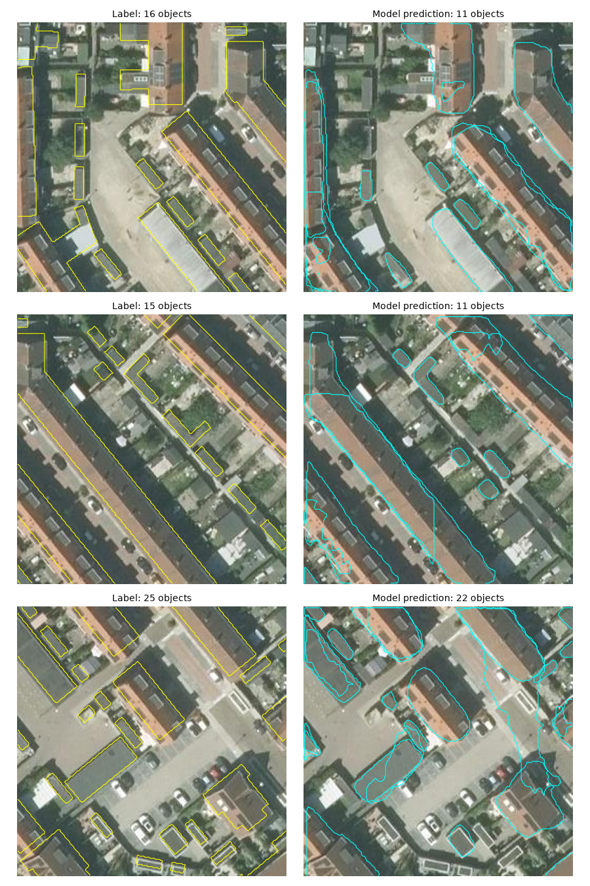

# Building footprint detection in Gouda

Instance segmentation of buildings in Dutch aerial imagery, using only open data and open-source tools,
plus a simple change-detection step that finds new buildings between 2020 and 2025.

At my previous job I trained a Mask R-CNN building detector on Maxar satellite imagery inside ArcGIS Pro.
This project rebuilds that workflow from scratch in Python and PyTorch, on Dutch open data,
and measures the result properly.

**Status:** pipeline complete; training in progress (best so far: epoch 2, validation F1 0.52).
Test-set results will be added when training is finished.



## Data

| Data | Source | Notes |
|---|---|---|
| Building footprints | BAG `pand` via [PDOK WFS](https://service.pdok.nl/lv/bag/wfs/v2_0) | Used as labels |
| Aerial imagery | Luchtfoto 2025 and 2020, 25 cm RGB via [PDOK WMS](https://service.pdok.nl/hwh/luchtfotorgb/wms/v1_0) | Saved as GeoTIFF tiles |

Everything is in EPSG:28992 (RD New). Study area: 1.5 x 1 km in Gouda (`107000 446500 108500 447500`),
six tiles of 500 x 500 m (2000 x 2000 px).

Label filtering: only BAG buildings with a status meaning the building exists
(`Pand in gebruik`, `Verbouwing pand`, ...) and a `bouwjaar` up to the photo year.
Buildings with only a permit (`Bouwvergunning verleend`) are in the register but not in the photo.



## Method

| Step | Script | What it does |
|---|---|---|
| 1 | `download_data.py` | BAG footprints (paged WFS requests) and aerial tiles (WMS, georeferenced with rasterio) |
| 2 | `make_chips.py` | 256 x 256 px chips with instance masks, optional merging of touching buildings into blocks |
| 3 | `train.py` | Mask R-CNN, ResNet-50 FPN, COCO pre-trained, fine-tuned for one class. Validation after every epoch, best epoch kept, early stopping |
| 4 | `evaluate.py` | Precision, recall and F1 at mask IoU 0.5, pixel IoU, recall by building size |
| 5 | `predict.py`, `api.py` | Predictions to polygons (GeoPackage), served as GeoJSON by a FastAPI service |
| 6 | `change_detection.py` | Compares predictions on 2020 and 2025 imagery and checks the new buildings against BAG `bouwjaar` |

**Spatial split.** Whole tiles, never mixed:

| Split | Tile | Content |
|---|---|---|
| Train | 4 tiles | industry, canal, terraced and detached housing |
| Validation | `107000_446500` | used only to pick the best epoch |
| Test | `107500_446500` | densest terraced housing; evaluated once, at the end |

## Results

### Run 1: BAG buildings as labels (1 epoch)

The first model was trained on the BAG buildings exactly as registered. On the test tile it scored
F1 0.13 (precision 0.21, recall 0.09), while large buildings over 150 m² were found well (recall 0.78).

The reason was the labels. A BAG `pand` is a legal unit: a row of ten terraced houses is ten panden under
one continuous roof, and every garden shed is a pand of its own. In the test tile, 1,334 of the 1,650
panden are smaller than 50 m². From 25 cm imagery you often can't see where one house ends and the next starts.

### Run 2: touching buildings merged into blocks

Touching BAG polygons were merged into blocks (`make_chips.py --dissolve`), so the labels match what the
camera can see. Validation tile, score threshold 0.5, mask IoU 0.5:

| Epoch | Precision | Recall | F1 | Pixel IoU |
|---|---|---|---|---|
| 1 | 0.416 | 0.468 | 0.440 | 0.315 |
| 2 | 0.444 | 0.617 | 0.516 | 0.429 |

Recall by size at epoch 2: 0.40 for objects under 50 m², 0.63 for 50–150 m², 0.86 above 150 m².
The mean IoU of correctly matched objects is 0.73.



Training ran on a laptop CPU (Intel i7-1185G7), about 35–40 minutes per epoch.

### Still to do

- Train until validation F1 stops improving
- Evaluate the best model once on the test tile (blocks and BAG panden)
- Change detection 2020 → 2025 with the final model (the 42 BAG buildings built 2021–2024 in the test tile are the reference)

## How to run

```
python -m venv .venv
.venv\Scripts\activate
pip install -r requirements.txt
pip install torch torchvision --index-url https://download.pytorch.org/whl/cpu

python src/download_data.py --bbox 107000 446500 108500 447500
python src/download_data.py --bbox 107500 446500 108000 447000 --year 2020 --imagery-only
python src/make_chips.py --dissolve --out data/chips_blocks --val-tile luchtfoto_2025_107000_446500
python src/train.py --data data/chips_blocks/train --val data/chips_blocks/val --max-epochs 12
python src/evaluate.py --data data/chips_blocks/test --name test_blocks
python src/predict.py data/raw/imagery/luchtfoto_2025_107500_446500.tif
python src/change_detection.py
uvicorn api:app --app-dir src
```

## Notes

<!-- Write this section yourself, in your own words, as you go.
     What did you notice in the data? What surprised you? What went wrong?
     Delete this comment when you start. -->
